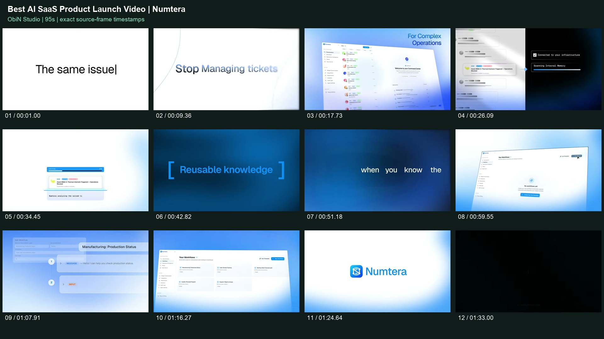
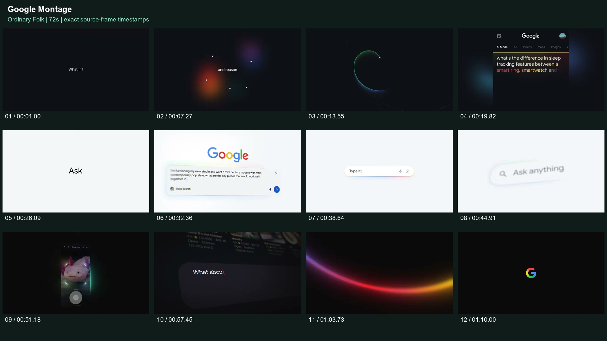
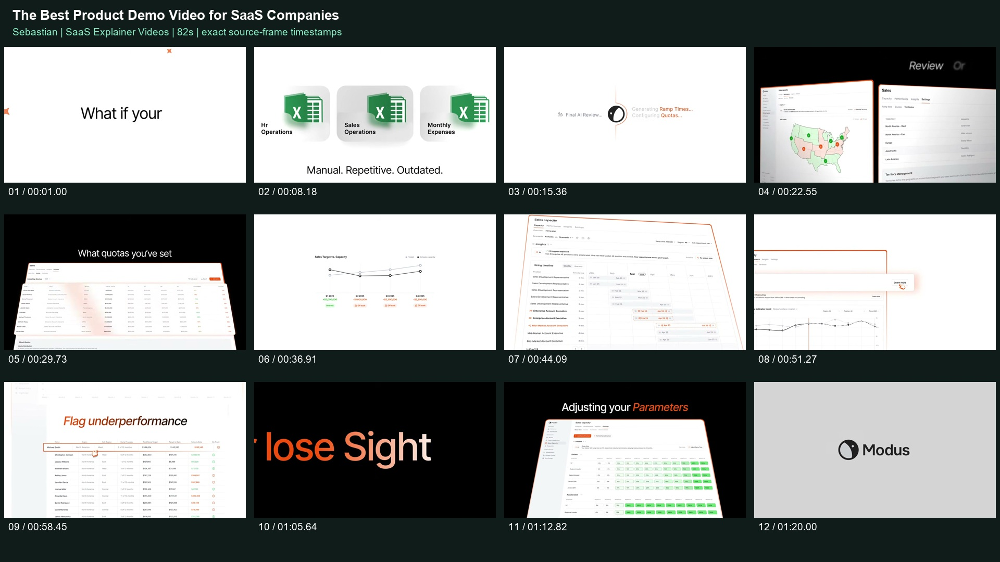
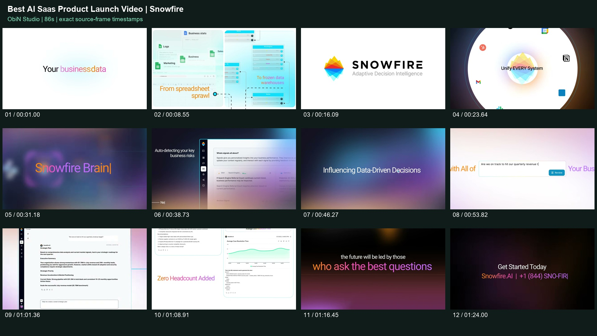

# Exvisit Studio - 60-second Meta launch ad

Production direction: read DESIGNER_BRIEF.md first. This is an AI-assisted planning proposal for a human designer. The final creative, motion, music selection, sound design and human narration must be authored and produced by people. Layout sketches illustrate rough intent only; develop original final frames.

Prepared 11 November 2026. User-selected CTA: **Download Exvisit Studio**.

This video tells developers that Exvisit gives them a place to understand their project, review agent changes and direct the work. The design is a signature dark opening, a light UI showcase and a dark download card.

## Timing overview

| Time | Shot | Screen message | Voiceover |
|---|---|---|---|
| 00-04s | 01. The question | AI writes your code. / Do you understand it? | AI writes your code. Can you explain what it built? |
| 04-08s | 02. From prompting to directing | Understand your project. / Direct your agents. | Stop chasing chat threads. Understand your project. Direct your agents. |
| 08-12s | 03. The product reveal | Exvisit Studio | Introducing Exvisit Studio by Hricor Research. Built in India. |
| 12-15s | 04. One workspace | Your tools. / Your way. | One workspace. Your tools. Your way. |
| 15-23s | 05. Stream: see the work | The work belongs / at the centre. | Stream mode puts agent changes at the centre. See the diff. Review the work. Stay in control. |
| 23-29s | 06. Editor: get hands-on | Code. Terminal. / Symbols. Git. | Want to get hands-on? Editor mode brings code, terminal, symbols, and Git together. |
| 29-34s | 07. Space: ask about the system | How does / sign-in work? | Need the bigger picture? Ask Space: how does sign-in work? |
| 34-40s | 08. Space: follow the flow | Follow the flow. / Open the source. | Follow the flow. Open the source. Add it to context. Keep building. |
| 40-44s | 09. Models and connected tools | Choose your models. / Connect your tools. | Choose your models. Connect your tools through MCP. |
| 44-51s | 10. Chat Studio: think and create | Think. Research. / Create. | Then switch to Chat Studio. Think, research, and create documents, slides, and spreadsheets in one place. |
| 51-55s | 11. The future-facing payoff | Understand the system. / Direct the work. | The next step in engineering starts with understanding. |
| 55-60s | 12. Download | Download / Exvisit Studio | Exvisit Studio. Zero platform fee with your own key. Download now. |

Voiceover: 130 words across 60 seconds. Individual line timing remains provisional until recorded.

## Video direction

### Format and composition
60.0 seconds; 9:16 full-bleed portrait. Working master 1080 x 1920, 30 fps; higher-resolution source captures for crops. The app is desktop software presented on a portrait canvas, not a fabricated mobile app.

### Colour arc
0-12s: signature forest #061C16 with mint #29F0B4 and warm white type. 12-55s: mint-white #F3F8F6 with deep ink #0B1F19. 55-60s: return to forest. Keep the real app theme as captured; a light background does not require recolouring dark UI.

### Type
Outfit 700/800 for headlines; Inter 500/600 for explanations and captions. At 1080-wide output, aim for 82-112px hero text, 42-54px labels and 40-48px captions. Show one emphasis word per line. Validate at phone size rather than treating these sizes as a guarantee.

### Portrait UI treatment
Use a full-window view only to establish context. Then crop to the action: diff, function, node, selector or artifact. Retain a small shell cue. Enlarge real controls rather than drawing replacement controls with invented behaviour.

### Working safe-area guide
Our conservative planning box is x=90-930 and y=285-1240 on a 1080 x 1920 canvas. Place headline around y=320-500, essential action around y=530-1080, captions around y=1120-1230. Fill the remaining canvas with background, shadows and nonessential context. This is a chosen working guide, not a verified Meta requirement; check the exact placements in Ads Manager before release.

### Motion
Use a clear action-to-result sequence: question, click, response, useful state. Typical type reveals take 8-12 frames; card entrances 12-18 frames; transitions 6-10 frames at 30 fps. Gentle overshoot on a card is fine; readable UI must settle. Do not keep zooming while the viewer reads.

### Transitions
Keep one motif: a fine mint line that underlines the opening, becomes the app border, highlights a flow and closes around the logo. Use action-driven match cuts between modes. The background change at 12 seconds is the major visual reset.

### Music
Proposed direction: energetic instrumental electronic music around 120 BPM, with a clean pulse from frame one, a bigger downbeat at 8 seconds, a fuller groove at 12 seconds, a brief opening around the Space question, and a resolve at 60 seconds. This is a music brief; reference audio has not been analysed or licensed.

### Voice
Confident, direct and curious. Clear Indian English is a strong fit for Built in India; choose a voice for clarity, not a caricature. Target a brisk natural read, with actual recorded timing taking precedence over estimated word rate.

### Sound and captions
Use small click, connection and node accents; music ducks beneath the voice. Burn in accurate captions, max two short lines, in the safe band. Do not stack a long headline, long caption and dense code in the same moment. A silent viewer must still understand the problem, mode benefits and download action.

### Texture and restraint
A subtle mint radial glow and soft card shadow are sufficient. No stock engineers, cyberpunk rooms, constant particle clouds, generic AI brains, decorative code rain or repeated white flashes.

### Final export
Deliver H.264 MP4, 1080 x 1920, 30 fps, AAC audio, sRGB/Rec.709 pipeline. Also deliver clean picture, caption file and separated voice/music/SFX tracks where the editor supports them. Review the exact Reels placement and destination before uploading.

## Frame 1 - The question
- status: outline
- duration: 4s
- time: 0-4s
- scene: AI writes your code. / Do you understand it?
- voiceover: AI writes your code. Can you explain what it built?
- asset_candidates: product-captures/hero_editor.jpg
- transition_in: The underline stretches into the edges of two overlapping chat cards.
- purpose: Create tension around understanding, without insulting developers or vibe coders.

0.0-1.4: The first line lands large on a deep forest background. A small Exvisit mark is already present.
1.4-2.4: A real code fragment passes behind the type at low contrast; the foreground stays readable.
2.4-4.0: The question replaces the first line. Hold the completed question for at least one second.

**Layout:** Type dominates the upper-middle of the portrait frame. Use a single mint underline under understand. Code is atmosphere, never required reading.
**Motion:** Two deliberate type reveals with a soft upward settle. A mint line advances across the frame; no strobe or glitch.
**Sound:** Immediate musical pulse, dry text impact and a short intake before the question.
**Source status:** Existing code image is a framing source. Capture final sign-in code for continuity.
**Reference:** Google 00:01.00; Numtera 00:01.00

## Frame 2 - From prompting to directing
- status: outline
- duration: 4s
- time: 4-8s
- scene: Understand your project. / Direct your agents.
- voiceover: Stop chasing chat threads. Understand your project. Direct your agents.
- asset_candidates: Official Exvisit logo and original motion graphics
- transition_in: Workspace border becomes the Exvisit hero frame.
- purpose: State the promise early: the human understands the system and directs the work.

4.0-5.2: Two generic chat-thread cards appear with short lines such as Change this and Explain that.
5.2-6.6: They compress into one workspace outline as Understand your project appears.
6.6-8.0: The word Direct lands; three small task blocks align beneath one human direction point.

**Layout:** Use abstract chat fragments, not ChatGPT or Claude branding. One portrait composition, with the outcome statement larger than the problem.
**Motion:** Cards converge and snap into a stable frame. The visual resolution should be obvious even without sound.
**Sound:** Percussion builds; one convergence whoosh, then a clean accent on Direct.
**Source status:** Graphic storyboard elements; not a claim about autonomous multi-agent orchestration.
**Reference:** Snowfire 00:08.55; Google 00:13.55

## Frame 3 - The product reveal
- status: outline
- duration: 4s
- time: 8-12s
- scene: Exvisit Studio
- voiceover: Introducing Exvisit Studio by Hricor Research. Built in India.
- asset_candidates: product-captures/hero_editor.jpg
- transition_in: The forest field opens to mint-white at 12 seconds. Keep the product frame continuous.
- purpose: Name the product and company, establish origin, and connect the opening to a real app.

8.0-9.0: The actual Exvisit logo locks into the workspace outline.
9.0-10.5: Exvisit Studio resolves; by Hricor Research sits beneath it.
10.5-12.0: Built in India appears as a small supporting line. The app window rises under the wordmark.

**Layout:** Logo and wordmark in the centre-safe band. App glimpse below, not behind the name. Keep origin secondary to product identity.
**Motion:** One controlled logo reveal and a short product-window lift. The mint line opens outward into a light field.
**Sound:** First major downbeat at 8 seconds. Short branded tone; no long logo interlude.
**Source status:** Actual local logo and old demo capture available. Final capture must match the shipping build.
**Reference:** Snowfire 00:16.09; Google 00:26.09

## Frame 4 - One workspace
- status: outline
- duration: 3s
- time: 12-15s
- scene: Your tools. / Your way.
- voiceover: One workspace. Your tools. Your way.
- asset_candidates: product-captures/hero_editor.jpg
- transition_in: Match the Stream tab position into the next shot, then enlarge the centre.
- purpose: Show that the product is a workspace before diving into individual modes.

12.0-13.0: Brief full-window view establishes the left project panel, centre work area and right agent panel.
13.0-14.2: Highlight the real Stream, Editor and Space tabs in sequence.
14.2-15.0: Land on Stream, with the central work area beginning to enlarge.

**Layout:** Full-bleed mint-white canvas; a large, dark app card sits in the central safe area. Its silhouette establishes context; tiny text is not the message.
**Motion:** Start with at most a slight 3D tilt, then flatten before any reading. Push towards the central work area.
**Sound:** The full groove begins; three restrained ticks identify the mode tabs.
**Source status:** Existing hero_editor.jpg establishes composition. Record mode tab selections anew.
**Reference:** Numtera 00:17.73; Modus 00:22.55

## Frame 5 - Stream: see the work
- status: outline
- duration: 8s
- time: 15-23s
- scene: The work belongs / at the centre.
- voiceover: Stream mode puts agent changes at the centre. See the diff. Review the work. Stay in control.
- asset_candidates: product-captures/stream_cart.jpg
- transition_in: The same file remains visible while the mode changes to Editor.
- purpose: Prove the principal difference: agent work is visible in the central workspace.

15.0-17.0: A real agent edit begins. Show just enough agent panel to identify where it came from.
17.0-19.5: The centre diff updates; bring one changed function forward so the added lines are visible.
19.5-21.5: Move to the actual review controls and select one real action. Use Mark reviewed if that is the final-build label.
21.5-23.0: Hold the reviewed state. Keep a small hint of the agent panel for orientation.

**Layout:** The central diff takes roughly two thirds of the action region. The agent stays subordinate. Use one diff hunk, not two unreadably narrow columns.
**Motion:** Move the camera to the changed lines, settle, then reveal the review action. Use a real before/after pair or recorded interaction.
**Sound:** Soft typing texture, one edit tick, one review click. Keep the narration clearly above percussion.
**Source status:** stream_full.jpg, stream_cart.jpg and stream_reviewed.jpg exist as old demo captures. Final source needs a continuous sign-in edit.
**Reference:** Numtera 00:26.09 and 00:34.45; Modus 00:58.45

## Frame 6 - Editor: get hands-on
- status: outline
- duration: 6s
- time: 23-29s
- scene: Code. Terminal. / Symbols. Git.
- voiceover: Want to get hands-on? Editor mode brings code, terminal, symbols, and Git together.
- asset_candidates: product-captures/hero_editor.jpg
- transition_in: Follow the Space tab or source-navigation action into the next shot.
- purpose: Show that agent-first work still provides the controls engineers need.

23.0-25.0: Select Editor and place the cursor in the same function seen in Stream.
25.0-27.0: Open a symbol and jump to its definition; give the code one clean hold.
27.0-28.0: Reveal the real terminal panel.
28.0-29.0: Show the actual Git changed-file panel, then move toward Space.

**Layout:** Main editor is the anchor. Terminal, Symbols and Git are quick sequential evidence beats, not four equal panels. Keep the mode label outside the app.
**Motion:** Use two short reframes rather than constant zooming. UI clicks cause the scene changes.
**Sound:** Three light clicks over the groove. Avoid a machine-gun effect for each code character.
**Source status:** Existing editor, symbols and Git screenshots available as visual sources. Capture final terminal and navigation interactions.
**Reference:** Modus 00:51.27 and 01:12.82

## Frame 7 - Space: ask about the system
- status: outline
- duration: 5s
- time: 29-34s
- scene: How does / sign-in work?
- voiceover: Need the bigger picture? Ask Space: how does sign-in work?
- asset_candidates: product-captures/space.jpg
- transition_in: Input settles as the real result graph enters the same canvas.
- purpose: Move from reading a file to asking a project-level question.

29.0-30.5: Enter Space with a clean canvas and the real input visible.
30.5-32.0: Type How does sign-in work? into the actual input.
32.0-34.0: Submit; show a brief real processing state or a clearly signalled time compression.

**Layout:** The question is the hero. Crop the input and its immediate canvas; keep the active Space tab in a small context strip.
**Motion:** One typing reveal and one submit action. Do not show the completed graph before the question is asked.
**Sound:** Drop one musical layer to make room for the question. A short input tick cues submission.
**Source status:** Available Space screenshot is checkout-related, not sign-in. It is a layout reference only. Record a new sign-in question and result.
**Reference:** Google 00:38.64; Snowfire 00:53.82

## Frame 8 - Space: follow the flow
- status: outline
- duration: 6s
- time: 34-40s
- scene: Follow the flow. / Open the source.
- voiceover: Follow the flow. Open the source. Add it to context. Keep building.
- asset_candidates: product-captures/space.jpg
- transition_in: The context chip becomes the visual bridge to model and tool choice.
- purpose: Show the complete question-to-understanding-to-action loop.

34.0-36.0: Reveal the actual sign-in graph. Frame three or four readable nodes, selected from the real result.
36.0-37.5: Follow one edge and select its source node. Let the source file or function reference read.
37.5-38.5: Click the actual Open or Edit control; show the corresponding source.
38.5-40.0: Return to the node, click Add to context, and show the composer attachment or chip.

**Layout:** Graph fills the central action area. Keep one path in focus, not the entire architecture. Enlarge the real source and context controls at the moment they are used.
**Motion:** Trace one path with a restrained highlight; move between nodes in a clear direction. The click must precede the resulting state.
**Sound:** Three soft node tones, then two distinct clicks. The groove rebuilds as context is attached.
**Source status:** Existing graph visibly contains checkout, total and subtotal. Replace it with a real sign-in result; never relabel that image as sign-in.
**Reference:** Numtera 01:07.91; Modus 00:51.27

## Frame 9 - Models and connected tools
- status: outline
- duration: 4s
- time: 40-44s
- scene: Choose your models. / Connect your tools.
- voiceover: Choose your models. Connect your tools through MCP.
- asset_candidates: product-captures/connect-mcps.webp
- transition_in: A supported tool result becomes a research item in Chat Studio.
- purpose: Show flexibility without implying universal agent or provider compatibility.

40.0-41.5: Open the actual supported-provider or model selector. Show two supported options clearly.
41.5-43.0: Cut to MCP settings or a connected-tool panel with real connected status.
43.0-44.0: Briefly show one tool being used or a genuine tool result before moving to Chat Studio.

**Layout:** Two sequential close-ups, not an orbit full of logos. The names must remain readable and keys must be hidden.
**Motion:** A compact selector reveal followed by a connected-state confirmation. Use the same card geometry as earlier shots.
**Sound:** A selector click and one soft connection chime.
**Source status:** Provider and MCP screenshots exist. Final connected status and tool result need fresh capture with demo credentials.
**Reference:** Snowfire 00:23.64 and 00:38.73

## Frame 10 - Chat Studio: think and create
- status: outline
- duration: 7s
- time: 44-51s
- scene: Think. Research. / Create.
- voiceover: Then switch to Chat Studio. Think, research, and create documents, slides, and spreadsheets in one place.
- asset_candidates: product-captures/draft-documents-and-edit.webp
- transition_in: The active artifact card pulls back into the full workspace.
- purpose: Explain why Chat Studio belongs here: thinking and artifacts stay beside the engineering work.

44.0-45.5: Switch to Chat Studio using the real application control. Show a project-related research or planning question.
45.5-47.0: Show a real cited research result or browser-backed answer, then open a document artifact.
47.0-48.5: Open a presentation preview with one strong, readable slide.
48.5-50.0: Open a spreadsheet; show a small set of meaningful cells.
50.0-51.0: Re-establish the shared app shell and hold the completed work.

**Layout:** One output at a time in the same app frame. Label Docs, Slides and Sheets beside the relevant output. Do not use a collage of six unreadable windows.
**Motion:** Use matching card edges for the artifact swaps. Headline stays anchored so the product feels like one workspace.
**Sound:** Three measured output ticks, with the music brightening. Narration remains the priority.
**Source status:** Docs, slides and sheets screenshots available. They are older web assets; record matching project content, and fresh research/browser action.
**Reference:** Snowfire 01:01.36; Modus 00:36.91

## Frame 11 - The future-facing payoff
- status: outline
- duration: 4s
- time: 51-55s
- scene: Understand the system. / Direct the work.
- voiceover: The next step in engineering starts with understanding.
- asset_candidates: product-captures/hero_editor.jpg
- transition_in: The line closes around the logo as the background returns to forest.
- purpose: Deliver the future-of-engineering argument as a clear position backed by what viewers just saw.

51.0-52.5: Pull back from the work to one composed Exvisit workspace.
52.5-54.0: The payoff line resolves, with understand receiving the only accent.
54.0-55.0: The mint line returns around the app frame and prepares the ending.

**Layout:** One workspace and one statement. Avoid team-replacement numbers, job-loss predictions or a claim that all software is already AI-written.
**Motion:** A restrained pull-back, then stillness. Give the viewer a short breath before the CTA.
**Sound:** Resolve the musical phrase and build a short lift into the end card.
**Source status:** Graphic payoff plus actual product hero. No performance or productivity claim is required.
**Reference:** Snowfire 01:16.45; Google 01:03.73

## Frame 12 - Download
- status: outline
- duration: 5s
- time: 55-60s
- scene: Download / Exvisit Studio
- voiceover: Exvisit Studio. Zero platform fee with your own key. Download now.
- asset_candidates: Official Exvisit logo and original motion graphics
- transition_in: End on the held card; export exactly 60.0 seconds.
- purpose: Make the next step unmistakable and state the pricing boundary clearly.

55.0-56.0: Logo and Exvisit Studio settle on the dark field.
56.0-57.5: Download Exvisit Studio appears with exvisit.in/download.
57.5-60.0: Hold the complete card. Show Zero platform fee with your own key and Model usage charged separately.

**Layout:** Put the CTA, URL and fee qualifier together in the centre-safe band. Keep by Hricor Research as a small supporting line. Bottom area may carry decoration, not required text.
**Motion:** One logo settle and one CTA reveal. The final 2.5 seconds are a stable read.
**Sound:** Final brand tone. Resolve music within 60 seconds; no abrupt tail or additional spoken slogan.
**Source status:** User-selected CTA. Verify the live download route and final pricing copy before release.
**Reference:** Snowfire 01:24.00; Numtera 01:24.64

## Editorial decisions

**Lead with understanding.** Your core idea survives: engineers must understand systems and direct agents. The opening asks a pointed question without framing the audience as lesser developers.

**Bring the product forward.** The product is named at 8 seconds. The small Exvisit mark is visible from the opening. Most of the minute demonstrates work rather than predicts the future.

**Replace absolute future claims.** Remove 100% of code, ten teams, hours not weeks, and only elite engineers remain. These are unproven generalisations and would consume the time needed to prove the product.

**Resolve the chat contradiction.** The problem is fragmented, chat-only engineering. Chat Studio remains useful for thinking, research and artifacts inside the same workspace. Do not claim that conversation itself is obsolete.

**Use precise compatibility language.** Choose your models and supported agents is more defensible than any model, any agent. Show the real options used in the capture.

**Keep the indexing explanation off the voiceover.** Code structure indexing and local semantic embeddings are different mechanisms. Say Follow the flow in the ad; explain implementation on the landing page or in a longer demo.

**Keep the fee boundary visible.** Use Zero platform fee with your own key. Put Model usage charged separately beside it. A free platform is not a claim of free model inference.

## Reference analysis

The four supplied videos were retrieved at 720p. Forty-eight timestamped frames were extracted and visually inspected. These stills establish composition and visual progression; music and detailed easing are proposed direction, not measured reference-audio analysis.

### Best AI SaaS Product Launch Video | Numtera
[ObiN Studio - 95 seconds](https://www.youtube.com/watch?v=awUYikrGsKk)
**Use for:** UI staging and feature reveals
A spare white opening gives way to blue-edged product views. A full interface establishes the product, then isolated workflow components make the mechanism easier to follow.

- 00:01.00: One sentence, one focal point. Adapt this restraint for the opening question.
- 00:17.73: Angled product window on a soft blue field. Use a mint field and a nearly flat Exvisit window.
- 00:26.09: A work item and a scanning panel form a clear relationship. Connect an agent action with its central diff.
- 00:34.45: Isolated ticket and progress state. Crop to one file change rather than shrinking the whole desktop.
- 00:59.55: Full interface returns to reorient the viewer. Re-establish Exvisit before switching modes.
- 01:07.91: Enlarged workflow steps explain structure. Apply the principle to the sign-in flow in Space.
**Avoid:** Do not import the blue identity, tiny sidebar text, or 95-second pacing into a phone ad.

### Google Montage
[Ordinary Folk - 72 seconds](https://www.youtube.com/watch?v=7Q4tHIp8UoI)
**Use for:** Dark signature opening and coherent dark-to-light transition
The opening uses near-black, restrained text and small coloured points. Later frames switch to a bright field with an isolated input; the coloured line becomes a recurring brand motif.

- 00:01.00: A small question on a dark field creates quiet tension. Enlarge the question substantially for Reels.
- 00:07.27: Coloured points suggest thought without literal circuitry. Exvisit needs one restrained mint motif.
- 00:13.55: A luminous curve concentrates attention. Let an Exvisit line become the edge of the app window.
- 00:26.09: The white field gives the next idea a clean reset. Make the Exvisit reveal the light-canvas switch.
- 00:38.64: An isolated input is readable. Use the same concentration for the Space question.
- 01:03.73: The light ribbon supplies continuity. Return to the mint line for the final brand card.
**Avoid:** Keep Google colours, its G mark and search identity out of the Exvisit design. Do not copy the quiet opening duration.

### The Best Product Demo Video for SaaS Companies
[Sebastian | SaaS Explainer Videos - 82 seconds](https://www.youtube.com/watch?v=q7N6fiUzfSU)
**Use for:** Feature explanation and attention control
The demonstrated product is Modus. Wide product views alternate with enlarged tables, charts and highlighted actions, on white or black fields with orange emphasis.

- 00:08.18: Repeated spreadsheet cards embody a problem. Use repeated chat threads only briefly, then resolve them.
- 00:22.55: Two product panels establish breadth. In portrait, stack or sequence panels instead of keeping them side by side.
- 00:36.91: One isolated chart becomes the entire point. Give each Exvisit mode one legible proof.
- 00:51.27: The Learn more action is pulled forward. Enlarge the real Open and Add to context controls.
- 00:58.45: A selected row ties a claim to a visible item. Highlight one function or one diff hunk.
- 01:12.82: A headline frames a detailed UI view. Place explanatory type outside Exvisit rather than over code.
**Avoid:** Avoid dense landscape tables, orange branding and labels that are too small to read on a phone.

### Best AI Saas Product Launch Video | Snowfire
[ObiN Studio - 86 seconds](https://www.youtube.com/watch?v=_2-DrtdMtos)
**Use for:** Fragmentation-to-one-workspace narrative
Scattered data and systems lead into a unified product. Brand statements alternate with UI proof, followed by a clear ending and direct call to action.

- 00:08.55: Multiple sources make fragmentation visible. Use chats, code and tools as the initial fragments.
- 00:16.09: The product name gets its own moment. Give Exvisit a decisive reveal rather than another feature label.
- 00:23.64: Connected systems surround one centre. Adapt to supported MCP tools around the Exvisit workspace.
- 00:38.73: A product panel supplies evidence after the statement. Every Exvisit benefit should reach a real screen.
- 01:01.36: An input is followed by substantial output. In Space, show the question followed by a readable flow.
- 01:16.45: A future-facing line precedes the CTA. Close on the engineer directing work, then Download Exvisit Studio.
**Avoid:** Do not reuse Snowfire gradients, its logo, revenue claims or business outcomes. Avoid a generic glowing AI orb.

## Capture list

**P01 - One real project.** Prepare a small authentication project whose sign-in flow can be followed across files. Use the same project in Stream, Editor and Space. If using the available coffee-cart source instead, change both narration and all relevant labels to the order-total question; never mix sign-in narration with a checkout graph.

**P02 - Stream source sequence.** Record agent prompt, real edit, central diff and a genuine review action. Capture full shell plus a clean close-up. Do not crop away the source identity while claiming multiple agent compatibility.

**P03 - Editor sequence.** Record the same function, symbol navigation, terminal and Git. Hide irrelevant paths and noisy output. Keep real labels and results.

**P04 - Space loop.** Record question, result, path navigation, source opening and Add to context confirmation. Keep the generated graph semantically faithful. A storyboard animation must never invent dependency edges.

**P05 - Models and MCP.** Record supported options, one connected MCP tool and one actual result. Use a demo account; no keys, private URLs or personal messages.

**P06 - Chat Studio.** Capture a useful research response and one document, one slide and one sheet on matching project content. Existing web screenshots establish visual treatment only.

**P07 - Brand and end card.** Use the official logo from the current app, approved company attribution, the verified download URL and the BYOK fee qualifier.

**P08 - Music and voice.** Choose a track cleared for paid social advertising. Record the final script; measure each line against its allocated time. If a line overruns, shorten it or rebalance within 60 seconds rather than squeezing speech unnaturally.

## Acceptance checks

- **Timing:** The planned timeline sums to exactly 60 seconds. Speech timing is still an estimate until a human voice recording exists.
- **Readability:** Review at 360 x 640 and on an actual phone. Each mode must be identifiable and its key action readable without pausing.
- **Causality:** Every click precedes its effect. Do not imply instantaneous generation when the source used a longer wait; mark meaningful compression as Time compressed.
- **Product truth:** Replay all recorded actions in the final release build. Confirm labels, supported models, tool connections, artifacts and download destination.
- **Ad preview:** Check the actual Reels preview and CTA overlays, including captions and fee qualifier. The proposed safe box is deliberately conservative, not a substitute for the preview.
- **Audio:** Listen on a phone speaker. Voice must remain clear through the main drop; there must be no clipped peaks or music tail beyond 60 seconds.
- **Source rights:** Reference frames are included for internal design study. Final ad must use Exvisit recordings and cleared audio, not the reference videos or their branding.
- **Approval boundary:** This handoff is a storyboard proposal. It does not claim a rendered, tested or published ad. Final capture, audio, edit, placement review and campaign launch remain production work.

## Source and evidence notes

- [Current public product description](https://www.exvisit.in/): Read on 11 November 2026: desktop agentic environment, free with own key, Code/Chat/Slides/Sheets/Docs/Research. The reader supplied only the landing text, not a complete feature audit.
- [Download destination](https://www.exvisit.in/download): Confirmed separately by a direct HTTP request during preparation; still replay the installer journey before release.
- [Meta placement guide](https://www.facebook.com/business/ads-guide/update/video/instagram-reels): The public fetch reached a login/block page. No current official safe-zone numbers are asserted. The safe-area box in this brief is an editorial working choice.

Local sources inspected: the existing Exvisit reel capture collection; web/public/product screenshot collection; web/src/data/docsData.ts and alternativesData.ts for BYOK wording; daemon/src/ide/embeddings.rs, search.rs and scip/mod.rs for the distinction between semantic search and structural navigation. Existing captures are not proof of the latest shipping-build behaviour.
